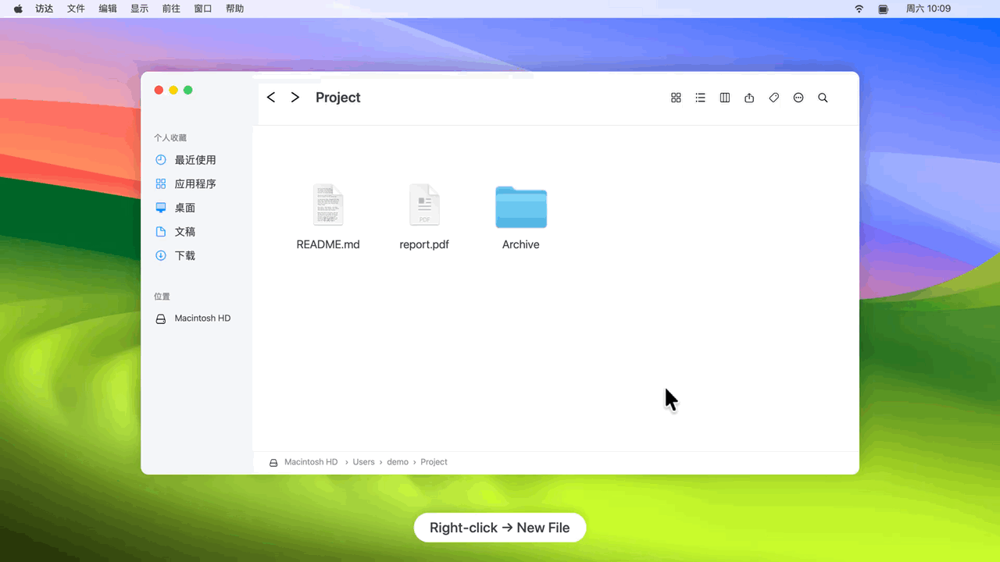
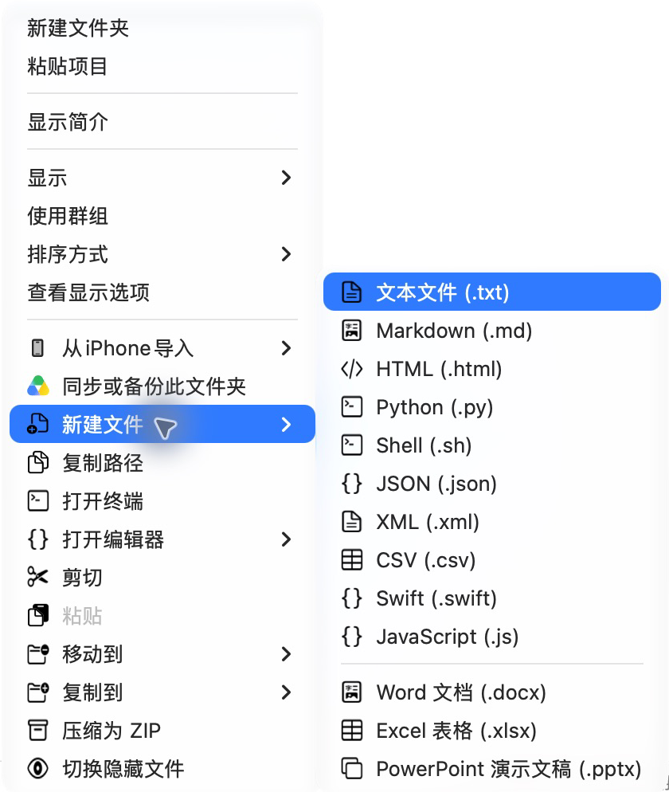
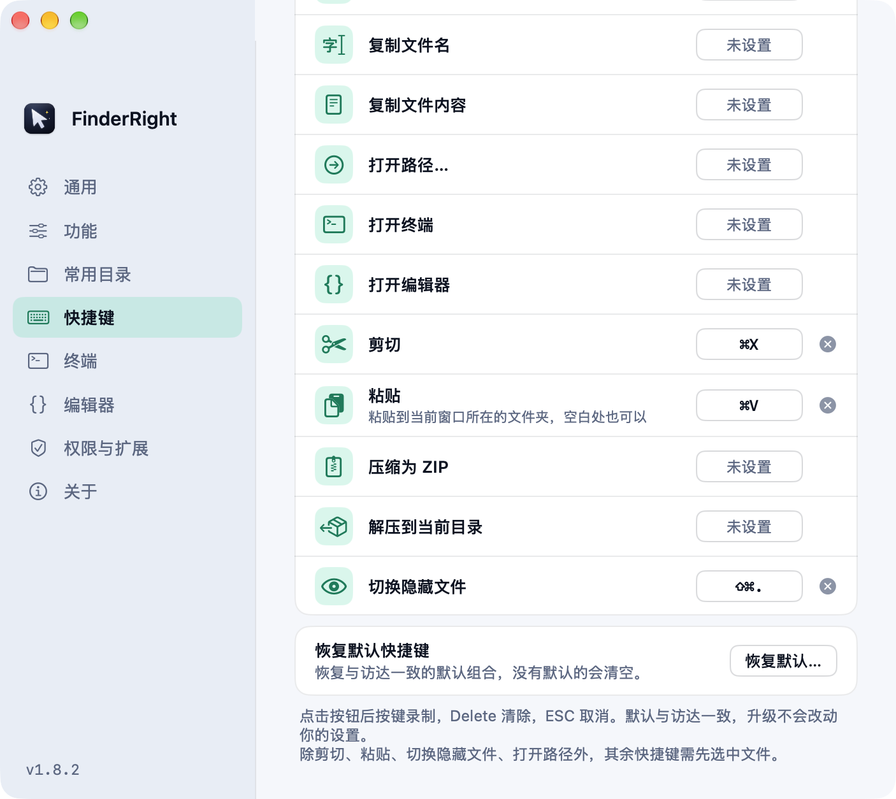
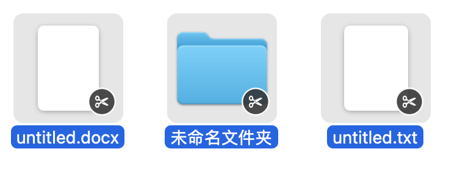

<div align="center">

# FinderRight

**给 Finder 加上右键新建文件、打开终端和剪切粘贴。**

**Create files, open a terminal, and cut & paste from Finder’s right-click menu.**

免费开源 · 文件操作在本地完成 / Free & open source · File operations stay on your Mac

[English](#english) · [中文](#中文)

[参与贡献 / Contributing](CONTRIBUTING.md) · [安全说明 / Security](SECURITY.md)

-blue)


<br/>
<br/>



如果 FinderRight 让你的日常操作更顺手，欢迎 [⭐ 点个 Star 支持](https://github.com/funny-dog/FinderRight)，也欢迎反馈使用问题。

If FinderRight makes your daily work easier, [⭐ star the project on GitHub](https://github.com/funny-dog/FinderRight). Feedback is welcome too.

</div>

---

## 中文

给 Mac 的 Finder 加上右键新建文件、打开终端和剪切粘贴——免费开源，文件操作在本地完成。适合经常管理项目文件的 Mac 开发者。

### ✨ 功能

- 📄 **新建文件** —— 一键新建 txt / Markdown / Python / Shell / JSON / Swift / JS 等十种文件，以及空白的 Word / Excel / PowerPoint 文档；还可在设置中添加自定义文本模板
- 📋 **复制路径** —— 复制选中文件/文件夹的完整路径；可在设置中改为 `~` 路径、仅文件名、终端转义路径或文件 URL
- 📋 **复制文件名** —— 独立复制完整文件名（含扩展名），多选时每行一项
- 📂 **打开路径** —— 输入或粘贴文件、文件夹路径（绝对路径或 `~/`），回车在 Finder 中显示（文件会在所在文件夹中选中），也可直接用默认 App 打开文件；自动清理复制来的引号、首尾空白、`file://` 链接和终端转义
- 💻 **打开终端** —— 在当前目录打开终端（支持系统默认终端，以及 Ghostty / Terminal / iTerm2 / Warp 等）
- ✏️ **打开编辑器** —— 用 Zed / VS Code / Cursor / Sublime / Xcode / JetBrains 等打开，自动识别常见编辑器，其他应用可在设置里手动添加
- ✂️ **剪切 / 粘贴** —— Finder 原生没有的"剪切文件"，剪切后的文件带角标，粘贴时才真正移动；在访达里直接用 ⌘X 剪切、⌘V 粘贴到当前文件夹（空白处也可以，快捷键可在设置中修改，需「辅助功能」权限）
- 📁 **移动到 / 复制到** —— 在设置中添加常用目录后，右键即可把选中项移动或复制过去
- 📦 **压缩 / 解压**（默认关闭，可在设置中开启）—— 压缩为 ZIP；选中压缩包可解压到当前目录（包内只有一个顶层文件夹时直接解出，不再套两层同名文件夹）
- ↩️ **撤销上一次操作** —— 移动到 / 复制到、剪切、右键粘贴、新建文件、压缩 / 解压之后，按 ⌘Z（需「辅助功能」）或从右键菜单撤销最近一次操作（菜单栏图标的「撤销」入口需开启「显示最近操作」）；与访达自己的撤销按先后顺序共存，文件被改过或原位置有同名项目时跳过并提示，删除一律进废纸篓
- 👀 **文件夹 / ZIP 快速查看** —— 选中文件夹或 ZIP 后按空格，或右键选择系统「快速查看」，以可展开列表查看名称、修改日期、大小和类型；ZIP 只读目录，不解压文件。需启用独立的 FinderRight Preview 快速查看扩展
- 👁 **切换隐藏文件** —— 即时显示/隐藏隐藏文件，**无需重启 Finder，不会关闭窗口或中断拷贝**（需辅助功能权限）
- ⌨️ **自定义快捷键与顺序** —— 给每个菜单项绑定快捷键，在访达里直接按键即可，无需展开右键菜单（授权「辅助功能」后由 FinderRight 直接处理，任意组合都能用、改完立即生效；未授权时除剪切 / 粘贴外自动退回系统服务快捷键）；默认快捷键与访达一致（⌥⌘C 复制路径、⇧⌘. 切换隐藏文件），升级不覆盖你的设置，可一键恢复默认，并可在设置中拖动调整它们在右键菜单中的顺序
- 🌗 **中英文双语** —— 默认跟随系统语言；设置里的「语言」可强制中文 / English，右键菜单即时生效（角标文案需重启访达后生效）
- 🔐 **升级免重新授权** —— 自 1.3.0 起使用固定证书签名，之后的版本升级会自动保留「完全磁盘访问」与「辅助功能」授权；自动更新还会校验新版本与当前版本出自同一证书，拒绝被篡改或冒充的更新包

### 📸 截图

<p align="center">
  
  &emsp;
  
</p>

<p align="center">
  <br/>
  <sub>剪切后的文件带剪刀角标，粘贴时才真正移动</sub>
</p>

### 📥 安装

> ⚠️ **芯片架构说明**：当前版本仅支持 **Apple Silicon（M 系列芯片，ARM64）**，要求 macOS 13.0+，暂不支持 Intel 架构。

1. 下载 **[FinderRight.dmg](https://github.com/funny-dog/FinderRight/releases/latest/download/FinderRight.dmg)** —— 此链接始终指向最新 Release
2. 打开 DMG，把 `FinderRight.app` 拖到 `Applications`
3. **首次打开**（应用未经 Apple 公证，需手动放行）：
   ```bash
   xattr -dr com.apple.quarantine /Applications/FinderRight.app
   ```
   然后双击打开；或右键 → 打开 → 在弹窗中选择"打开"。
4. 启动后按引导：
   - **启用 Finder 扩展**：系统设置 → 隐私与安全性 → 扩展 → 访达扩展 → 勾选 FinderRight
   - **授予完全磁盘访问**（在受保护目录使用所有功能）
   - **授予辅助功能**（让"切换隐藏文件"无需重启 Finder）

> ⚠️ 当前版本使用自签名证书签名，未经 Apple 公证，因此需要第 3 步手动放行。若未来提供 Developer ID 公证版，可省去第 3 步。

### 文件夹与 ZIP 预览

安装并启动 FinderRight 后，在「设置 → 权限与扩展 → 扩展」中打开 **文件夹与 ZIP 预览**；关闭此开关会停用 FinderRight Preview，恢复系统默认预览。开关与系统扩展设置同步；也可在系统设置中搜索「扩展」，在「快速查看」中管理 **FinderRight Preview**（与「访达扩展」是两个独立开关，入口随 macOS 版本而异）。切换后重新打开快速查看窗口。回到 Finder，选中文件夹或 `.zip`，按空格或右键选择系统「快速查看」即可。只提供只读列表，支持展开子目录及点击列标题排序，不提供包内文件内容预览、拖出或解压操作。

- 文件夹展开时才读取子目录；包含隐藏项，不展开符号链接或 `.app` 等文件包，也不递归统计目录大小。
- 每层文件夹最多显示 2,000 项，ZIP 最多显示 10,000 条目录记录；达到上限会提示内容不完整。
- 第一版支持普通 ZIP，不支持 ZIP64、分卷 ZIP、RAR / 7z 等其他格式；损坏包、读取失败会显示原因。能读取中央目录的加密 ZIP 可显示条目，但不会解密文件内容。
- 受保护目录、尚未下载的云盘文件是否可读，取决于系统授予预览扩展的访问权限；主 App 的完全磁盘访问权限不会自动授予该扩展。其他 App 若也提供相同类型的 Quick Look 扩展，可能影响系统选择。

### 🔄 升级说明

可以通过应用内「关于」页面的自动更新直接升级，或手动下载最新版 `FinderRight.dmg` 拖入 `Applications` 覆盖。

> 💡 **版本升级注意事项**：
> 1. **重启访达（重要）**：macOS 系统会缓存 FinderSync 扩展进程。覆盖安装或更新后，**务必在终端执行以下命令重启访达**，以使系统加载最新版本的扩展插件（否则右键菜单或剪切角标可能不会即时刷新）：
>    ```bash
>    killall Finder
>    ```
> 2. **权限重新授权说明**：自改用固定的自签名证书签名起，新旧版本的签名身份相同，**「完全磁盘访问权限」与「辅助功能权限」在升级后会自动保留**。唯一的例外是从 **1.2.0 及更早版本**（Ad-hoc 签名，`codesign -s -`）**首次升级**到 1.3.0 或更新版本：macOS 的安全管控机制（TCC）会判定其为不同身份的程序，需要按下面的方法重新授权一次。此时系统设置里的开关可能看起来仍显示开启，但底层校验实际已失效。
>    - **完全磁盘访问**：前往「系统设置 → 隐私与安全性 → 完全磁盘访问权限」，将 FinderRight 的开关**关闭再重新开启**（或点 `-` 删除后重新拖入添加）。
>    - **辅助功能权限**：前往「系统设置 → 隐私与安全性 → 辅助功能」，选中 FinderRight 点击底部的 **`-`（减号）删除**，再重新打开应用添加即可。
>    - **终端一键重置法（推荐，最省心）**：
>      ```bash
>      tccutil reset SystemPolicyAllFiles com.finderright.app
>      tccutil reset Accessibility com.finderright.app
>      ```
>      执行后重新打开 FinderRight 即可按引导一次性勾选授权。
> 3. **先退出旧版**：若旧版正在后台运行，建议先在菜单栏点击图标选择「退出 FinderRight」后再拖动覆盖。
> 4. **解除拦截**：覆盖后若提示未公证拦截，请重新执行：
>    ```bash
>    xattr -dr com.apple.quarantine /Applications/FinderRight.app
>    ```

### 🗑️ 完全卸载

若需彻底清理应用及配置残留，可在终端执行：

```bash
killall FinderRight 2>/dev/null || true
rm -rf /Applications/FinderRight.app
rm -rf ~/Library/Application\ Support/FinderRight
rm -f ~/Library/Preferences/com.finderright.app.plist
tccutil reset All com.finderright.app 2>/dev/null || true
killall Finder
```

### 🛠 从源码构建

网站源码位于 [`website/`](website/)，预览与部署说明见该目录的 README。

方式一（推荐，无需 Xcode，仅需 Command Line Tools）：

```bash
bash scripts/setup-signing.sh  # 仅首次：生成自签名证书并导入钥匙串（发布构建必需，请备份私钥）
bash scripts/ci.sh             # 编译 Kit + 单元测试 + 主程序/扩展静态类型检查
bash scripts/build.sh          # 产出 FinderRight.app 与 DMG / ZIP（有证书时用证书签名，否则退回 ad-hoc）
```

方式二（Xcode 工程，需 Xcode 16+ 和 [xcodegen](https://github.com/yonaskolb/XcodeGen)）：

```bash
brew install xcodegen
xcodegen generate
xcodebuild -scheme FinderRight -configuration Release \
  -derivedDataPath build/release build
```

### ⚠️ 已知行为与取舍

- **后台操作结果看菜单栏**：压缩 / 解压 / 粘贴在提交给主 App 后立即返回「已受理」，不弹通知（以避免任何权限弹窗打扰）。在设置「通用 → 显示最近操作」中开启后（默认关闭），结果会列在菜单栏图标的「最近操作」里：成功项点击可在访达中定位产物，失败项点击查看原因；有未查看的失败时菜单栏图标会变红。菜单栏顶部的「撤销」项也归这个开关管，关掉后不再出现（⌘Z 与访达右键菜单里的「撤销」不受影响）。记录只保存在内存中，退出 App 即清空；若在设置中隐藏了菜单栏图标，则看不到这一提示。详细日志仍可在 Console.app 中搜索 FinderRightService。
- **加密 / 分卷压缩包**：加密的 ZIP 会弹密码框，密码错误可以重试，取消则跳过；系统 bsdtar 能解 `.7z` 与 `.rar`（含 RAR5）。加密的 7z / RAR 和分卷包仍会解压失败，开启「最近操作」后可在菜单栏查看失败原因（解压中途产生的临时文件会被自动清理）。
- **菜单生效范围**：Finder 扩展只注册用户主目录与已挂载卷；`/Applications`、`/Users/Shared` 等系统目录不会出现右键菜单，云盘目录改由「服务」子菜单提供（见下节）。
- **终端工作目录**：Ghostty / Alacritty / Kitty 只有在**尚未运行**时才能通过命令行参数指定工作目录（`open --args` 的固有限制）；已在运行时退化为目录 URL 方式，能否换目录取决于各终端自身实现。
- **剪切状态**：粘贴过程中若主 App 被强退/崩溃，下次启动会自动把未移动完的剪切路径恢复回队列（移动成功的不会回来）。

### 🏗 架构

- **主 App**（未沙箱）：菜单栏 + 设置界面，借用 TCC 权限执行实际文件操作
- **Finder 扩展**（沙箱）：负责右键菜单
- **Quick Look 扩展**（只读沙箱）：负责文件夹 / ZIP 内容预览，空格与系统右键「快速查看」共用
- **IPC**：扩展通过"文件 + URL scheme"唤醒主 App 执行操作，无需 App Group / 付费开发者账号

### ☁️ iCloud / Google Drive 等云盘

iCloud Drive、Google Drive、OneDrive、Dropbox 等云盘在 macOS 上是 **File Provider 域**，目录归云盘自己的扩展管理。Apple 技术支持（DTS）的说明是：Finder 扩展按「一个目录只归属一个扩展」设计，第三方扩展在其他云盘提供者管理的目录里本就不应期望生效（见 [Keka #1327 中转述的 DTS 答复](https://github.com/aonez/Keka/issues/1327)）。在 macOS 27 上对 iCloud Drive 与 Google Drive 实测，显式注册目录、授予目录访问权限后右键菜单依然不出现；完全磁盘访问同样改变不了这一点。因此在这些云盘文件夹里，FinderRight 的操作改为出现在 **右键 →「服务」子菜单**：复制路径 / 复制文件名 / 打开路径 / 新建文件（含模板） / 移动到常用目录 / 复制到常用目录 / 打开终端 / 打开编辑器 / 剪切 / 粘贴到此文件夹 / 压缩 / 解压。

使用 FinderRight「剪切」后，在目标目录空白处选择「服务 → FinderRight：粘贴到此文件夹」。本机 Google Drive 实测空白处可传入当前目录；若未显示「服务」，可返回上一级，右键目标文件夹调用同一服务。粘贴服务只接受一个现存目录，不接受普通文件或多选；它移动的是 FinderRight 剪切队列中的文件，不是系统剪贴板里的复制项。若系统在调用时激活 FinderRight，会先展示目标路径，确认后才移动文件；取消不会取走剪切队列。复制文件名保留扩展名，多选时每行一项；打开路径可在选中文件或文件夹后从右键服务调用，弹出路径输入框；选中项不决定要打开的路径，目标由输入内容决定。新建文件服务只接受一个现存文件夹，确认框可选择内置文本类型、Office 空白文档和设置中的自定义模板，默认文件名为 untitled，同名自动编号。移动到／复制到服务支持多选，在确认框中选择设置里的常用目录并查看目标完整路径；取消确认不操作文件。取消剪切尚未提供服务入口。「服务」菜单的标题由 macOS 按系统语言显示（中文系统显示中文，其他语言显示英文），不随 FinderRight 设置里的界面语言切换。

### 🩺 常见问题排查

| 症状 | 原因与处理 |
| --- | --- |
| 右键完全没有 FinderRight 菜单 | 确认「系统设置 → 隐私与安全性 → 扩展 → 访达扩展」中已勾选 FinderRight，再重启访达。两者都可在「设置 → 权限与扩展 → 右键菜单排查」中一键完成。 |
| 升级后菜单或角标还是旧的 | 系统缓存了旧的扩展进程，重启访达即可（见「升级说明」）。 |
| 云盘文件夹里没有菜单 | 系统限制，改用「右键 → 服务」子菜单（见「iCloud / Google Drive 等云盘」）。 |
| `/Applications`、`/Users/Shared` 等系统目录没有菜单 | 扩展只注册用户主目录与已挂载卷，这些目录同样通过「右键 → 服务」使用。 |
| 菜单里没有压缩 / 解压 | 默认关闭，在「设置 → 功能 → 右键菜单功能」中开启。 |
| 快捷键按了没反应 | 授予「辅助功能」权限。除剪切、粘贴、切换隐藏文件、打开路径外，其他快捷键要先选中文件。未授权时剪切、粘贴不可用，其他快捷键退回系统服务快捷键，改完要重启访达。 |
| 剪切后没有剪刀角标 | 其他访达扩展（如 Keka）可能占用了该目录的角标显示权。剪切本身不受影响，照常粘贴即可；也可在「设置 → 功能」开启「自动解决角标冲突」。 |
| 压缩、解压、粘贴后看不到结果 | 这些操作在后台执行，不弹通知。开启「设置 → 通用 → 显示最近操作」后，结果和失败原因会列在菜单栏图标里。 |
| 打开终端没有切到当前目录 | Ghostty / Alacritty / Kitty 已在运行时无法通过参数指定目录（见「已知行为与取舍」）。 |
| 升级后权限开关是开的却不生效 | 从 1.2.0 及更早版本升级需要重新授权一次（见「升级说明」）。 |
| 选中文件夹或 ZIP 按空格仍是系统预览 | 在「设置 → 权限与扩展 → 扩展」打开「文件夹与 ZIP 预览」，再重新打开快速查看窗口。 |

### 📄 许可证

[MIT](LICENSE)

---

## English

Create files, open a terminal, and cut & paste from Finder’s right-click menu. FinderRight is free and open source, with file operations performed locally on your Mac. Built for Mac developers who work with project files every day.

### ✨ Features

- 📄 **New File** — create txt / Markdown / Python / Shell / JSON / Swift / JS and more with one click, plus blank Word / Excel / PowerPoint documents; add your own text templates in Settings
- 📋 **Copy Path** — copy the full path of selected files/folders; switch to a `~` path, file name only, shell-escaped path or file URL in Settings
- 📋 **Copy File Name** — copy full file names including extensions; multiple selections are copied one per line
- 📂 **Go to Folder** — enter an absolute path or a `~/` path to open the folder in Finder
- 💻 **Open in Terminal** — open the current folder in your default terminal, or choose Ghostty / Terminal / iTerm2 / Warp, etc.
- ✏️ **Open in Editor** — open with Zed / VS Code / Cursor / Sublime / Xcode / JetBrains IDEs, etc. Common editors are detected automatically; any other app can be added in Settings
- ✂️ **Cut / Paste** — the "cut file" that Finder lacks natively; cut files get a badge and are only moved when you paste; cut with ⌘X and paste into the current folder with ⌘V right in Finder (works with nothing selected; the keys can be changed in Settings; requires Accessibility permission)
- 📁 **Move To / Copy To** — add favorite folders in Settings, then move or copy the selection there from the right-click menu
- 📦 **Compress / Extract** (off by default, enable in Settings) — compress to ZIP; extract archives in place (an archive with a single top-level folder is extracted as that folder, not nested inside another one)
- ↩️ **Undo Last Action** — after Move/Copy To, Cut, Paste from the menu, New File, Compress or Extract, press ⌘Z (needs Accessibility) or use the context menu to undo the most recent one (the menu bar Undo item requires Show Recent Activity); it interleaves with Finder’s own undo in order, skips items that changed or whose original location is taken (with a notice), and only ever moves things to the Trash
- 👀 **Folder / ZIP Quick Look** — press Space or choose Finder’s native Quick Look context-menu item to browse an expandable, sortable contents list without extracting ZIP files. Toggle it in FinderRight Settings → Permissions & Extensions → Extensions → Folder and ZIP previews. The switch follows the system extension setting; turning it off restores the system default preview. Reopen Quick Look after changing it. Read-only; no file-content preview or extraction. Includes hidden items, loads folders on expansion, and does not follow symbolic links or browse app packages. Limited to 2,000 items per folder and 10,000 ZIP records, with a partial-results notice. ZIP64, split ZIP, and other archive formats are not supported. Access to protected or cloud-only files depends on the extension’s sandbox permissions, independently of the main app’s Full Disk Access.
- 👁 **Toggle Hidden Files** — instantly show/hide hidden files **without restarting Finder, so windows stay open and copies keep running** (needs Accessibility)
- ⌨️ **Custom Shortcuts and Order** — bind a keyboard shortcut to any menu item and press it right in Finder without opening the context menu (with Accessibility permission FinderRight handles them directly, so any combination works and changes apply immediately; without it, everything except Cut / Paste falls back to system Services shortcuts); defaults match Finder (⌥⌘C Copy Path, ⇧⌘. Toggle Hidden Files), updates never overwrite your shortcuts, and you can restore the defaults in one click, and drag to reorder them in Settings
- 🌗 **Bilingual** — follows your system language by default; the in-app "Language" setting can force English / 简体中文 and applies to the context menu immediately (the badge label updates after Finder restarts)
- 🔐 **No Re-authorization on Upgrade** — signed with a fixed certificate since 1.3.0, so later upgrades keep the Full Disk Access and Accessibility permissions; the auto-updater also verifies that a new version is signed with the same certificate and rejects tampered or impostor packages

### 📸 Screenshots

<p align="center">
  
  &emsp;
  
</p>

<p align="center">
  <br/>
  <sub>Cut files get a scissors badge and are only moved when you paste</sub>
</p>

> The screenshots show the Chinese interface; FinderRight is also fully available in English.

### 📥 Installation

> ⚠️ **Architecture Requirement**: The pre-built release currently supports **Apple Silicon (M-series, ARM64)** Mac only, running macOS 13.0+. Intel (x86_64) architecture is not supported.

1. Download **[FinderRight.dmg](https://github.com/funny-dog/FinderRight/releases/latest/download/FinderRight.dmg)** — this link always points to the latest release
2. Open the DMG and drag `FinderRight.app` into `Applications`
3. **First launch** (the app is not notarized by Apple, so Gatekeeper must be bypassed):
   ```bash
   xattr -dr com.apple.quarantine /Applications/FinderRight.app
   ```
   Then double-click to open, or right-click → Open → choose "Open" in the dialog.
4. Follow the onboarding:
   - **Enable the Finder extension**: System Settings → Privacy & Security → Extensions → Finder Extensions → check FinderRight
   - **Grant Full Disk Access** (to use all features in protected folders)
   - **Grant Accessibility** (so "Toggle Hidden Files" doesn't need to restart Finder)

> ⚠️ This build is signed with a self-signed certificate and is not notarized by Apple, so step 3 is required. A Developer ID notarized build would remove step 3.

### 🔄 Upgrading from Older Versions

You can upgrade directly via the built-in auto-updater in the "About" tab, or manually download the latest `FinderRight.dmg` and drag `FinderRight.app` into `/Applications` to overwrite the existing version.

> 💡 **Upgrade Tips**:
> 1. **Restart Finder (Important)**: macOS caches FinderSync extension processes. After upgrading or overwriting the app, **always restart Finder via Terminal** to ensure the new extension bundle is loaded (otherwise the context menu or badges may not update immediately):
>    ```bash
>    killall Finder
>    ```
> 2. **Permission Re-authorization Notice**: Builds are now signed with a fixed self-signed certificate, so new versions keep the same code signing identity and **Full Disk Access and Accessibility permissions are preserved across updates**. The only exception is the **first update** from **1.2.0 or earlier** (ad-hoc signed, `codesign -s -`) to 1.3.0 or later: macOS Transparency, Consent, and Control (TCC) treats it as a different app, so re-grant the permissions once as described below, even if the toggle switches in System Settings still appear to be ON.
>    - **Full Disk Access**: Go to System Settings → Privacy & Security → Full Disk Access, toggle FinderRight OFF and back ON (or remove it with `-` and re-add).
>    - **Accessibility**: Go to System Settings → Privacy & Security → Accessibility, select FinderRight, click the **`-` (minus)** button to remove it, then restart the app to re-add.
>    - **One-click Terminal reset (Recommended)**:
>      ```bash
>      tccutil reset SystemPolicyAllFiles com.finderright.app
>      tccutil reset Accessibility com.finderright.app
>      ```
>      Then reopen FinderRight to complete the onboarding permission prompt.
> 3. **Quit the old version**: If running, select "Quit FinderRight" from the menu bar before overwriting.
> 4. **Bypass Gatekeeper**: Run:
>    ```bash
>    xattr -dr com.apple.quarantine /Applications/FinderRight.app
>    ```

### 🗑️ Complete Uninstall

To completely remove FinderRight and all associated preferences, staging files, and cache:

```bash
killall FinderRight 2>/dev/null || true
rm -rf /Applications/FinderRight.app
rm -rf ~/Library/Application\ Support/FinderRight
rm -f ~/Library/Preferences/com.finderright.app.plist
tccutil reset All com.finderright.app 2>/dev/null || true
killall Finder
```

### 🛠 Build from Source

Website source lives in [`website/`](website/); see its README for preview and deployment instructions.

Option 1 (recommended, no Xcode needed — Command Line Tools only):

```bash
bash scripts/setup-signing.sh  # first time only: create the self-signed certificate (required for release builds; back up the private key)
bash scripts/ci.sh             # build the Kit + unit tests + type-check app & extension
bash scripts/build.sh          # produces FinderRight.app plus DMG / ZIP (certificate-signed when available, otherwise ad-hoc)
```

Option 2 (Xcode project; requires Xcode 16+ and [xcodegen](https://github.com/yonaskolb/XcodeGen)):

```bash
brew install xcodegen
xcodegen generate
xcodebuild -scheme FinderRight -configuration Release \
  -derivedDataPath build/release build
```

### ⚠️ Known Behavior and Tradeoffs

- **Background results live in the menu bar**: compress / extract / paste acknowledge the request immediately ("accepted") and never post notifications (to avoid any permission prompt). After turning on **General → Show Recent Activity** in Settings (off by default), outcomes are listed under **Recent Activity** in the menu bar icon: click a success to reveal the output in Finder, or a failure to see why; the icon turns red while there are failures you haven't seen. The **Undo** item at the top of that menu follows the same switch, so it disappears when the switch is off (⌘Z and the Undo item in the Finder context menu are unaffected). The history is kept in memory only and is cleared when the app quits; if you hide the menu bar icon in Settings you won't see this indicator. Detailed logs are still available in Console.app (search `FinderRightService`).
- **Encrypted / multi-volume archives**: encrypted ZIPs prompt for a password, retry on a wrong one and are skipped when cancelled; the system bsdtar handles `.7z` and `.rar` (including RAR5). Encrypted 7z / RAR and split archives still fail, with the reason shown in the menu bar when Recent Activity is on (temporary files from the attempt are cleaned up automatically).
- **Menu coverage**: the Finder extension only registers your home folder and mounted volumes, so `/Applications`, `/Users/Shared` and similar system folders show no context menu; cloud folders are covered by the Services submenu (see below).
- **Terminal working directory**: Ghostty / Alacritty / Kitty can only receive a working directory through command-line arguments while they are **not yet running** (an inherent `open --args` limitation). If they are already running, FinderRight falls back to opening the folder URL, and whether the directory changes depends on the terminal itself.
- **Cut state**: if the main app is force-quit or crashes mid-paste, the paths that were not moved yet are restored into the cut queue on next launch (already-moved ones are not).

### 🏗 Architecture

- **Main app** (non-sandboxed): menu bar + settings UI, runs the actual file operations using its TCC permissions
- **Finder extension** (sandboxed): provides the right-click menu
- **IPC**: the extension wakes the main app via a file + URL scheme to perform actions — no App Group or paid developer account required

### ☁️ iCloud / Google Drive and other cloud folders

iCloud Drive, Google Drive, OneDrive, Dropbox and similar cloud storage are **File Provider domains** on macOS, and their folders are owned by the provider's own extension. According to Apple Developer Technical Support (DTS), Finder extensions are designed around a single owning extension per folder, so a third-party extension should not be expected to work inside a folder managed by another cloud provider (see [the DTS reply quoted in Keka #1327](https://github.com/aonez/Keka/issues/1327)). Testing on macOS 27 with iCloud Drive and Google Drive confirmed it: the right-click menu still did not appear after explicitly registering the folders and granting folder access, and Full Disk Access does not change this either. Inside these cloud folders, FinderRight's actions appear under **right-click → Services** instead: Copy Path / Copy File Name / Go to Folder / New File (including templates) / Move to Favorite Folder / Copy to Favorite Folder / Open in Terminal / Open in Editor / Cut / Paste into This Folder / Compress / Extract.

After using FinderRight's Cut, right-click empty space in the destination folder and choose **Services → FinderRight: Paste into This Folder**. On the tested Mac, Google Drive can pass the current folder for this action. If Services is absent, go to the parent folder and right-click the destination folder instead. Paste requires one existing directory, rejects files and multiple selections, and moves FinderRight's cut queue rather than items copied to the system clipboard. If the system activates FinderRight during invocation, it shows the destination path and asks for confirmation before moving files; cancelling preserves the cut queue. Copy File Name keeps extensions and writes one name per line for multiple selections. Go to Folder is available from the right-click Services menu after selecting a file or folder. It opens a path prompt; the entered path determines the destination, independently of the selection. New File requires one existing folder. Its confirmation dialog offers built-in text types, blank Office documents, and custom templates from Settings; the default name is untitled, with numbering on conflicts. Move/Copy to Favorite Folder supports multiple selections and shows configured favorites with their full paths in a confirmation dialog. Cancelling performs no file operation. Cancel Cut does not yet have a service entry. Service titles are shown by macOS in the system language (Chinese on a Chinese system, English otherwise) and do not follow the interface language chosen in FinderRight's Settings.

### 🩺 Troubleshooting

| Symptom | Cause and fix |
| --- | --- |
| No FinderRight items in the right-click menu at all | Make sure FinderRight is checked under System Settings → Privacy & Security → Extensions → Finder Extensions, then relaunch Finder. Both are one click away in Settings → Permissions & Extensions → Troubleshooting. |
| Menu or badges still look old after upgrading | macOS caches the old extension process; relaunch Finder (see "Upgrading from Older Versions"). |
| No menu inside cloud folders | A system limitation; use right-click → Services instead (see "iCloud / Google Drive and other cloud folders"). |
| No menu in `/Applications`, `/Users/Shared` and other system folders | The extension only registers your home folder and mounted volumes; use right-click → Services there as well. |
| No Compress / Extract in the menu | Off by default; turn them on in Settings → Features → Right-Click Menu Features. |
| Shortcuts do nothing | Grant Accessibility permission. Apart from Cut, Paste, Toggle Hidden Files and Go to Folder, shortcuts need a selected item. Without Accessibility, Cut and Paste are unavailable and the other shortcuts fall back to system Services shortcuts, which need a Finder relaunch after changes. |
| No scissors badge after cutting | Another Finder extension (such as Keka) may hold the badge slot for that folder. Cutting still works and you can paste as usual; you can also turn on "Resolve Badge Conflicts Automatically" in Settings → Features. |
| No visible result after compress / extract / paste | These run in the background without notifications. Turn on Settings → General → Show Recent Activity to see outcomes and failure reasons in the menu bar icon. |
| Open in Terminal doesn't switch to the folder | Ghostty / Alacritty / Kitty can't receive a working directory while already running (see "Known Behavior and Tradeoffs"). |
| Permissions look enabled but don't work after upgrading | Upgrading from 1.2.0 or earlier requires authorizing once more (see "Upgrading from Older Versions"). |
| Pressing Space on a folder or ZIP still shows the system preview | Turn on "Folder and ZIP previews" in Settings → Permissions & Extensions → Extensions, then reopen the Quick Look window. |

### 📄 License

[MIT](LICENSE)
